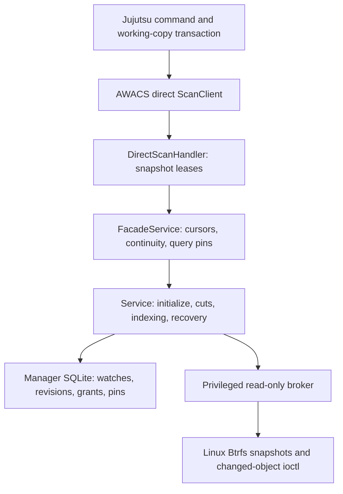

# AWACS and Jujutsu implementation specification

## 1. Purpose and status

AWACS maintains a snapshot-based change index for Btrfs subvolumes. Its
supported client boundary is the direct Jujutsu backend: Jujutsu receives an
opaque cursor, a conservative invalidation, and an open read-only snapshot
directory descriptor, then builds its working-copy tree from that immutable
snapshot.

This document describes the implementation in this repository and its companion
Jujutsu checkout at `../jj`. It distinguishes implemented mechanisms, intended
invariants, verified defects, and unsupported features. A schema table, helper
function, design proposal, or environment-gated test is not evidence that a
production path works.

### 1.1 Daemon-free architecture

Jujutsu and Git-hook callers enter through the in-process coordinator. There
is no persistent per-user daemon, scan socket, activation path, or daemon-owned
maintenance. The manager schema contains durable control-plane state only;
namespace paths are resolved by the broker from immutable comparison
endpoints instead of being persisted locally.

The AWACS library embedded by Jujutsu, and the short-lived
`git-fsmonitor-awacs` hook process, coordinate directly through one
independent state bundle per worktree:

```text
<git-admin-dir>/awacs/<live-subvolume-uuid>/
    manager.sqlite3
    manager.sqlite3-wal
    manager.sqlite3-shm
    root.lock
    spool/
    managed/
        cut-<operation-id>/
            snapshot
        quarantine/
```

Manager connections keep the WAL when the final direct caller closes. Each
commit remains `synchronous=FULL`; automatic passive checkpoints run at 1,000
WAL pages, and recycled WAL files are limited to 4 MiB. Closing an oversized
WAL also attempts a truncating checkpoint with no busy wait, so a succession
of short callers does not retain an oversized file indefinitely. A reader
retaining an older snapshot can defer that checkpoint and exceed the limit.
The WAL is committed database state: copying only `manager.sqlite3` is not a
backup. Use SQLite's backup API or take a consistent snapshot of the complete
state bundle, including WAL files.

For a main worktree, `<git-admin-dir>` is `<worktree-root>/.git`; for a linked
worktree, it is that worktree's resolved `$GIT_COMMON_DIR/worktrees/<id>`
administrative directory. This keeps staged main-worktree activation and
linked-worktree cleanup aligned with Git's own metadata lifecycle, while each
root still owns a small operational manager database. Descendants create a
fresh operational database rather than inheriting namespace state.
`BTRFS_AWACS_STATE_DIR` may override that root. Non-Git AWACS
callers retain the legacy private hidden-sibling default. The managed snapshot
directory remains private and on the same Btrfs filesystem as the worktree.
There is no per-worktree daemon socket, daemon lock, pid file, or persistent
lease directory. The privileged broker remains
as a stateless helper for bounded snapshot create/destroy and changed-object
ioctls over authenticated passed fds; it owns no watches, cursors,
or recovery state.

Each coordinator entrypoint acquires an exclusive `flock` on `root.lock`.
The simple target intentionally serializes snapshot creation, changed-object
processing, SQLite publication, returned-fd opening, and cleanup for one
worktree. SQLite transactions atomically publish logical state; Btrfs
snapshot names make external effects recoverable without a persistent
operation journal.

The database stores watches, snapshots, revisions, comparisons, cut events,
cursors, leases, and recovery metadata. It does not store a materialized
inode/reference graph.

`cuts` contains one row for every committed logical boundary, including a
cut with no changed paths. It records the expected UUID of the physical head
snapshot but is not a snapshot create/delete log. `cut_events` contains
normalized conservative path invalidations for one adjacent cut
(`PathAdded`, `PathRemoved`, `PathChanged`, `SubtreeMoved`, or a full
invalidation). It is not a historical namespace index.

For committed head N, a cut proceeds as follows:

1. Verify that `s-N` exists, is read-only, and has the UUID recorded by
   `cuts(N)`.
2. Reconcile the managed directory. Delete uncommitted `s-*` orphans and
   old committed snapshots whose pathnames are no longer needed.
3. Create and verify `s-(N+1)`.
4. Compare immutable `s-N` to `s-(N+1)` through the stateless broker.
5. Ask the broker to resolve changed inodes at both immutable endpoints and
   derive `cut_events(N+1)`.
6. In one SQLite transaction, insert `cuts(N+1)`, insert its events,
   advance `head_sequence`, and update hashes.
7. Open and verify any immutable scan-root fd that will be returned to the
   caller before releasing `root.lock`.
8. After commit, unlink older snapshot paths. Failed deletion is harmless
   and is retried by the next caller.

Sequence allocation uses the next committed sequence, not the highest filename
in the managed directory. If `s-(N+1)` exists while `cuts(N+1)` does not,
it is an uncommitted orphan from a crashed attempt: delete it and reuse
N+1. The design never deletes `s-N` before the transaction publishing
N+1 commits. If the committed head is absent or has the wrong UUID, AWACS
fails closed or requires reinitialization rather than guessing.

This ordering removes the need for durable create/delete operation rows:

```text
snapshot exists, cuts(N) absent:
    uncommitted orphan; delete and retry N

cuts(N) committed, older snapshots still exist:
    committed head is valid; retry old-path cleanup

old snapshot deletion interrupted:
    retry deletion on the next coordinator entry
```

Cursor replay reads adjacent events without reopening every old snapshot or
retaining its namespace index. At each adjacent cut, AWACS materializes
path-level `cut_events` while both immutable endpoints are available. A cursor
for sequence A answered at head B unions events from A+1 through B. The
physical snapshots named by the current Jujutsu journal and Git index remain
retained independently, together with their complete replay intervals.

Before cleanup, AWACS reads the worktree's published Git index directly and
reconciles its AWACS cursor with a separate durable consumer pin. This includes
indexes with an omitted checksum, linked-worktree administrative paths, and
indexes which have not queried their newly persisted cursor. It does not run
Git, rewrite its index, or walk the repository tree. A valid current index
remains protected while idle, regardless of its age or newer JJ cuts. Failure
to establish the index's retention roots prevents destructive cleanup rather
than treating an uncertain root as absent.

Git fsmonitor protocol v2 does not acknowledge durable token persistence.
AWACS therefore also retains issued response candidates for the lifetime of
the Git process that can publish them. Process identity includes its lifetime,
so PID reuse cannot release another process's protection. Concurrent responses
have independent protection: finishing one hook or observing a newer index
must not release a candidate that another live process can still publish.
Once a process exits, cleanup reconciles the actual index before releasing its
candidate pins. These roots use separate owners in the existing v14 pin table;
they do not change deployed cursor formats, journal records, or the database
schema.

Response protection is installed before Begin releases the root lock. Opening
another direct client on the same boot preserves existing response leases and
comparison pins; ordinary lease expiry reclaims abandoned work. Interrupted
non-expiring preparations receive a finite recovery grace. Reboot recovery
invalidates the previous boot's leases.

Deploy the updated Git hook and JJ together, after draining older hook
processes. Older binaries cannot register their pending publications; the new
pins protect existing references from their collectors but cannot account for
responses those older hooks have not yet published.

Deploy the paired Git update to make AWACS query failures fatal instead of
falling back to a full index refresh. An established AWACS cursor must advance
incrementally; unavailable replay or a whole-tree invalidation fails the Git
command before the fallback path updates the index. Initial setup and migration
from a numeric or built-in token retain their bootstrap refresh. Explicit
initialization or baseline recovery publishes an all-dirty numeric placeholder
before that refresh instead of deliberately failing a hook query. A still-valid
Git cursor skips the placeholder. Finalization still performs ordinary refreshes
so an explicit retry can finish warming the index after an interrupted attempt.
A second successful refresh persists clean bits for stat entries rewritten
during initialization before children inherit the index. Older running Git
processes keep their previous fallback policy, so drain them before an upgrade
when full scans must be avoided.

AWACS additionally tracks validated **incoming query cursors** on each watch's
Git lane. Issuing a response is not evidence of persistence:
`GIT_OPTIONAL_LOCKS=0` can leave the same token in the index across arbitrarily
many queries and newer cuts. Bootstrap requests without a cursor, internal
index seeding alone, and scan completion do not advance this observed state.
Creation may separately observe a cursor read back from its validated, published
child index before releasing the scan lease.

Let N be the highest valid cursor actually queried. N remains protected
until a query with a higher cursor supersedes it. Supersession starts a grace
period for the former N, using the time of supersession, not the snapshot's
creation time. A subsequent valid query with an older cursor refreshes that
cursor's grace without lowering N. Further advances of N do not restart the
grace of cursors that were already superseded. The default grace is 24 hours;
`ServiceConfig::with_replay_retention(_, duration_ns)` configures it together
with the supplemental replay cache age.

This timing rule protects overlapping readers. An index token A may already
be a month old when a newer token B is finally written. A process could have
read A seconds before another process queries B; aging A from its creation
would reclaim it immediately. Starting grace when B is observed, and
extending it only when A is actually queried again, gives that older reader
time to finish without retaining every superseded cursor forever. Observing
B is a retention heuristic, not proof that all older readers or alternate
indexes have stopped using A.

Retention preserves the **complete replay interval** from the oldest
protected index root, response candidate, observation, Jujutsu consumer, or
active query through the current head. The ordinary 128-cut/24-hour cache is
supplemental and cannot override these protections. Migration never infers a
queried cursor from an issued cut; cleanup still protects an existing published
index before the first post-upgrade Git query. Observation and pruning validate
and update their state in SQLite writer transactions so GC cannot slip between
validation and protection.

An elapsed grace period makes old history eligible for pruning; it does not
invalidate history that is still retained. A late valid query can refresh
its grace if its exact replay remains available. Once history is actually
pruned, a query cannot resurrect it: Git receives a fresh token plus `/`
for a whole-index refresh, never an empty "nothing changed" result.
Malformed or mismatched watch, grant, filesystem, snapshot, or epoch claims
are rejected without updating observations. This fallback preserves
correctness for old cursors which are no longer protected by a published
index or live publisher; it cannot recover a previously deleted endpoint.

`awacs init` and the shared conversion helper configure `core.fsmonitor=true`
only when it is not already set in local Git configuration. Git selects the
available fsmonitor implementation; AWACS does not configure an explicit hook
pathname or change `core.fsmonitorHookVersion`.

The returned scan-root fd is the intended scan-lifetime retention mechanism.
After a newer head commits, an older snapshot pathname may be unlinked while
an in-flight Jujutsu scan continues through its already-open fd. All
traversal must therefore be fd-relative; callers must not reopen the managed
pathname. Real-Btrfs acceptance must prove that recursively opening and
reading descendants through an already-open snapshot-root fd still works
after the snapshot pathname is deleted. If supported kernels do not provide
that behavior, add per-snapshot shared/exclusive flock guards as a fallback;
do not restore the persistent daemon.

The steady-state storage target is:

```text
O(control-plane metadata)
    + O(changed paths in the retained event window)
    + O(current JJ and Git snapshots plus still-publishable Git response snapshots)
    + O(unlinked snapshots held by open scan fds)
```

Completed Git responses that no published index references do not retain one
physical snapshot or full namespace index per historical token. Explicit
alternate index paths are tracked independently within their mount namespace.
Paths inside the checkout follow checkout relocation. A missing alternate index
releases its roots after every publisher for that registered path has exited,
including indexes outside the checkout. While a publisher remains live, both
the current index root and its response candidates stay protected. Other
namespace views remain conservative because they cannot prove absence.
A missing canonical index preserves its known roots without blocking alternate
index reconciliation.
To move an external index independently, copy it to the new path and run Git
with the new `GIT_INDEX_FILE` before removing the old path, so the hook registers
the new location while the old reference remains protected.
The hook requires an identifiable Git publisher before opening a scan client.
Direct calls without a Git ancestor, or calls whose publisher identity cannot
be read, fail without issuing a cursor or creating response pins. Once captured,
an identified publisher whose liveness cannot be checked remains conservatively
pinned until its completion can be established.
A highest observed Git cursor that never advances can retain an
indefinitely growing logical event interval. The 128-cut/24-hour cache limits
are not hard storage caps for protected history. Observation records contain
only watch/sequence identity and timing metadata; they do not add raw token
logging or data transmission, but the longer retention of local path events
is intentional. Physical snapshots become eligible for GC after their current
index, JJ baseline, response publisher, and scan references have ended.

AWACS requires Linux, Btrfs, an appropriate privileged broker, and the reviewed
changed-object/dirty-witness kernel support. The direct Jujutsu backend
requires a Jujutsu binary built with its optional `awacs` Cargo feature. The
ordinary Jujutsu default remains `fsmonitor.backend = "none"` and
`btrfs.enabled = false`.

## 2. Direct immutable-scan contract

Ordinary Jujutsu snapshots read files from the live working-copy directory.
The direct AWACS backend instead selects an immutable cut and returns:

- one open read-only snapshot directory fd;
- an opaque cursor for that exact logical cut;
- Full, ExactPaths, or Prefixes invalidation; and
- filesystem/subvolume identity for the opened snapshot.

Jujutsu must read relative to the retained descriptor and
must persist the new cursor only with the tree state derived from that same
snapshot. It must not reopen the managed snapshot pathname after Begin. If
descriptor identity, continuity, external inputs, or invalidation paths cannot
be proven, the client must abort or conservatively perform a full traversal.

## 3. Process topology and authority



There are three authority domains:

1. The client owns Jujutsu working-copy state.
2. The embedded coordinator opens the per-root manager database, serializes
   state transitions with root.lock, and owns the short-lived scan session.
3. The privileged broker performs bounded read-only Btrfs inspection over
   authenticated passed file descriptors.

A direct-scan request must not supply the broker's underlying authority,
manager database, managed-snapshot directory, or arbitrary commands.

## 4. Source ownership

| Component | Source | Responsibilities |
| --- | --- | --- |
| Btrfs identity and kernel calls | [`src/btrfs.rs`](src/btrfs.rs) | Open subvolume roots, inspect identity, create/destroy snapshots, and invoke changed-object interfaces. |
| Kernel stream parser | [`src/manifest.rs`](src/manifest.rs) | Parse versioned records, changed-object masks, reference changes, target attributes, and completion data. |
| Changed-object materialization | [`src/tree_index.rs`](src/tree_index.rs) | Materialize requested target objects from changed-object records. |
| Endpoint event projection | [`src/index.rs`](src/index.rs) | Turn broker-resolved endpoint paths and changed-object records into semantic path events. |
| Database bootstrap | [`src/store.rs`](src/store.rs) | Configure SQLite, extract the normative schema, migrate, and load cursor-key metadata. |
| Durable manager | [`src/manager.rs`](src/manager.rs) | Own watches, grants, snapshot pins, operation fencing, cuts, revisions, client boundaries, leases, retention, and recovery. |
| Privileged filesystem inspection | [`src/broker.rs`](src/broker.rs) | Validate expected fds/identities, execute bounded changed-object reads and batched endpoint path lookups, and fence sessions. |
| Broker wire protocol | [`src/broker_protocol.rs`](src/broker_protocol.rs) | Authenticate broker sessions and encode fd-passing requests. |
| Core orchestration | [`src/service.rs`](src/service.rs) | Initialize watches, create cuts, stage/apply comparisons, recover effects, and expose maintenance helpers. |
| Namespace continuity | [`src/namespace.rs`](src/namespace.rs) | Bind the exact root and mount view, observe relevant topology changes, and reject continuity loss. |
| Cursor and path projection | [`src/compat.rs`](src/compat.rs) | Authenticate direct cursors and conservatively project semantic events. |
| Snapshot facade | [`src/facade.rs`](src/facade.rs) | Verify continuity, request cuts, resolve baselines, mint cursors, and manage query leases. |
| Public direct-scan API | [`src/scan.rs`](src/scan.rs) | Define Begin/Renew/Promote/Finish/ReleaseBaseline and carry one already-open snapshot fd. |
| Embedded direct coordinator | [`src/scan_facade.rs`](src/scan_facade.rs) | Bind requests to initialized roots, retain prepared responses, renew/release leases, and remember completed sessions. |
| Executable | [`src/main.rs`](src/main.rs) | Run initialization, broker, diagnostics, and the Git fsmonitor hook. |

The companion checkout adds Btrfs-backed workspace materialization and the
optional direct AWACS snapshot backend. Its relevant ownership lies in
`../jj/lib/src/fsmonitor.rs`, `../jj/lib/src/working_copy.rs`,
`../jj/lib/src/local_working_copy.rs`, `../jj/cli/src/cli_util.rs`, and the
Btrfs workspace commands.

## 5. Filesystem and namespace model

A supported root is an exact Btrfs subvolume root. Snapshot identity includes
filesystem UUID, subvolume UUID, root ID, parent/received UUID where relevant,
transaction information, read-only status, and the caller's mount/root view.
A reused pathname or replaced mount cannot substitute for the original root.

Managed snapshots live outside the watched worktree and on the same Btrfs
filesystem. Nested subvolumes and unsupported fscrypt views are outside the
supported contract.

Broker endpoint resolution returns raw-byte repository-relative paths.
Hardlinks produce multiple visible names for one inode. Internal paths are
repository-relative raw bytes; direct responses use `Full` rather than a
sentinel path when a narrowed scan cannot be proven safe.

The semantic event kinds are `PathAdded`, `PathRemoved`, `PathChanged`,
`SubtreeMoved`, and `DirectoryDirtyWitness`. Directory witnesses and subtree
moves are inputs to conservative endpoint projection. A direct scan reads the
opened immutable snapshot, so live mutations after Begin cannot change the
tree being traversed.

## 6. Durable state and deployment layout

The manager database contains filesystems, watches, grants, operations,
snapshots, revisions, comparisons/events, client
boundaries, query/retention leases, and pins. SQLite foreign keys are enabled;
schema SQL is checked in alongside the store implementation in
[`src/store_schema.sql`](src/store_schema.sql).

The deployment layout is:

```text
<git-admin-dir>/awacs/<live-subvolume-uuid>/
    manager.sqlite3
    manager.sqlite3-wal
    manager.sqlite3-shm
    root.lock
    spool/
    managed/
        cut-<operation-id>/
            snapshot    # read-only Btrfs subvolume

/tmp/btrfs-awacs-broker/
    private request directory watched by the privileged broker
```

`BTRFS_AWACS_MANAGED_DIR`, `BTRFS_AWACS_SPOOL_DIR`,
`BTRFS_AWACS_MANAGER_DB`, and `BTRFS_AWACS_BROKER_DIR` override the
corresponding paths. The broker identifies requesters with fanotify-delivered
pidfds, duplicates their operation descriptors with `pidfd_getfd`, and replies
through an anonymous pipe. BTRFS_AWACS_PROBE_ROOT names a readable Btrfs subvolume
root that the privileged broker probes at startup; it refuses to listen if
the running kernel returns ENOTTY for BTRFS_IOC_CHANGED_OBJECTS. Runtime
state directories must be private.

## 7. Core lifecycle

`awacs rsnapshot <src> <dst>` creates a writable snapshot of a Btrfs subvolume
and recursively snapshots every nested subvolume at the same relative path.
Nested snapshots retain their source's read-only setting. The destination must
not exist, must be outside the source tree, and must have an existing parent on
the same filesystem. Discovery uses Btrfs subvolume references rather than
walking every ordinary file. AWACS builds in a private staging directory, then
publishes the complete tree with an atomic rename that never replaces an
existing destination. Failures remove the staging tree; a cleanup failure
reports its retained path.
Each snapshot receives a new Btrfs UUID, and snapshots of different subvolumes
are separate operations rather than one atomic view of the entire tree.
Callers must coordinate concurrent writers and identity-bound application state.

Git and Jujutsu worktree creation use the same recursive snapshot helper,
without special cases for `.git` and `.jj` snapshot creation. Git worktree
creation still replaces copied `.git` metadata with its registered gitfile and
stages the compact JJ journal before removing copied `.jj` metadata for later
adoption.

Replacing a main Jujutsu checkout is rejected while linked-worktree AWACS state
remains beneath its Git administrative directory. Direct `awacs init` likewise
rejects conversion that would replace Git metadata containing that state.
Recursive snapshots preserve the contents but assign new snapshot UUIDs, so
existing cursors would still reference the original snapshots. Already-enabled
finalization and an in-place rebuild of the main checkout's own baseline remain
available.

awacs init <root> is the explicit bootstrap boundary. It converts the root to
the shared Btrfs subvolume layout, resolves and verifies the source subvolume,
reserves a watch, grant, operation, and destination, creates a read-only
snapshot, reopens and verifies that snapshot, builds a complete userspace
path/inode index, validates the graph and metadata, and publishes revision
zero. jj util subvolume enable calls the same conversion and bootstrap
helpers. Opening an uninitialized root through the direct client is an error;
a scan request never creates a watch.

Sequence zero establishes core watch identity but is not a client cursor
boundary. A later synchronized cut produces the first client-visible cursor.

For a cut, AWACS takes root.lock, creates and verifies the next snapshot,
compares immutable endpoints, stages events and overlays, validates the target,
and publishes the indexed head and client boundary in SQLite. The returned
open snapshot fd retains an in-flight scan after older snapshot pathnames are
unlinked.

Each Jujutsu workspace persists one opaque cursor. A committed scan atomically
promotes candidate B with the Jujutsu tree state; a failed scan does not
advance the cursor. ReleaseBaseline clears the direct caller's logical
baseline and triggers bounded cleanup.

Recovery reconciles fenced manager operations before retrying effects. It must
reject unmanaged lookalike snapshots, stale grants, continuity loss, and
mismatched identities. Each direct coordinator entry performs bounded lease
expiry, retained-boundary cleanup, orphan-history reclamation, and physical
garbage collection while holding the per-root lock.

### 7.1 Git snapshot worktree index handoff

A persisted Git fsmonitor cursor names a logical replay position whose physical
endpoint remains pinned while the index references it. Clean Git commands may
leave that cursor unchanged while JJ advances and cleanup runs. Worktree
creation captures one stable copy of the source index, including cursor A and
its dirty bitmap, and begins a source scan that returns replay A → B plus a
temporary lease on physical cut B.

The recursive snapshot still clones the live source. Creation establishes an
independent child Git baseline and leases its actual cut C, then compares the
immutable B and C endpoints through the broker. Before publishing a child-owned
cursor for C, it unions A → B replay, B → C changes, and nested-subvolume prefixes
into the copied dirty bitmap. Existing dirty bits remain set. Nested prefixes
cover contents omitted by the non-recursive AWACS cuts; Git administrative paths
are excluded.

An empty transition preserves the warm bitmap and relocates the untracked cache.
Any changed path discards untracked-cache validity so Git rebuilds it against the
child. Missing or expired source proof requires full copied-cache invalidation
against a valid child cut, while retaining index entries and leaving fsmonitor
enabled. Creation reads back and observes the published child cursor before
finishing its lease and releasing the source lease. Git then classifies the actual
child, removes copied untracked paths, and materializes the requested commit.

Native JJ adoption still uses its separately retained semantic baseline and
consumer. Git's logical cursor never substitutes for that physical JJ seed; both
consumers advance independently after creation.

## 8. Direct API and Jujutsu transaction

The embedded library exposes Begin/Renew/Promote/Finish/ReleaseBaseline.
Begin returns one fd, cursor, invalidation, identity, deadline, and session
capability. Renew extends the lease. Finish records Committed or Aborted and
releases the prepared response.

Jujutsu's direct transaction:

1. Builds ignore rules, sparse matchers, tracking policy, and a versioned
   external-input fingerprint.
2. Sends the prior AWACS cursor only when backend and fingerprint still match.
3. Validates the returned descriptor and immutable identity.
4. Traverses `/proc/self/fd/N` while retaining the fd and renewal owner.
5. Builds tree/file state from the immutable snapshot.
6. Saves tree state and matching cursor atomically.
7. Sends Finish only after the durable save succeeds.

Failure, reset, checkout, sparse mutation, or uncacheable paths abort the
pending session and clear the cursor. A failed Finish after a successful save is
cleanup failure; the saved tree/cursor pair remains the client-side result.

The supported configuration is:

```toml
[fsmonitor]
backend = "awacs"

```

Unsupported platforms or feature-disabled binaries reject awacs; a configured
direct backend fails closed when initialization, identity, or lease
verification fails.

## 9. Btrfs-backed Jujutsu workspaces

Btrfs workspace mode is independent of the direct backend:

```toml
[btrfs]
enabled = false   # true, false, or "auto"
```

Snapshot workspace creation must replace copied `.jj` identity with independent
working-copy metadata and, for colocated repositories, independent linked Git
worktree state. When the source has initialized AWACS state, creation also
copies its current path/inode graph into fresh sequence-zero child state and
cuts a child-owned s-0 immutable baseline snapshot before setup mutates the
copied metadata. The child gets a fresh SQLite store, spool, root lock,
logical cut/event history, and managed snapshot directory; it must not
reference the parent database, cursor, event history, or managed snapshot.
Optional fallback must discard snapshot-only baselines and materialize files
through the ordinary Jujutsu path.

Required safety invariants include protecting shared repository stores,
detecting dirty or replaced targets before removal, checking deletion capability
before forgetting registrations, preserving auto-mode fallback, preventing
unsupported nested subvolumes, materializing widened sparse destinations, and
cleaning linked Git worktree metadata.

## 10. Concurrency, performance, and active gaps

Cut publication is serialized per root by root.lock. Expensive filesystem work
must run outside writer transactions. Query leases retain exactly the logical
revisions and comparisons needed by an active response or scan. Direct
Begin/Renew/Finish must not hold global locks across unrelated expensive work
or blocking writes; deadlines need one coherent monotonic time base.

Current verified gaps include shared-workspace deletion hazards, fabricated
fallback baselines, unresolved companion dependency paths, invalid target
wedges, missing production retention, filesystem-wide flush cost, retained
boundary foreign-key failures, external-ignore drift, lease/deadline
disagreement, descriptor delegation risk, slow Begin
starvation, sparse workspace materialization failures, incomplete kernel
identity checks, abandoned session pins, malformed invalidation handling, and
installer friction.

## 11. Validation and support boundary

Meaningful validation requires Linux, the supported modified Btrfs kernel,
eligible disposable Btrfs subvolumes, the privileged broker, and an
AWACS-enabled Jujutsu build. Required checks cover:

- clean builds with and without the optional AWACS feature;
- direct scans against real read-only snapshot fds;
- unlinking a managed snapshot while recursively traversing its already-open
  root fd;
- immutable scan isolation from post-Begin live mutations;
- hardlinks, directory moves, sparse state, ignores, EOL/exec policy, and
  malformed invalidations against an independent full-scan oracle;
- zero-event cuts, orphan snapshot recovery, crash after snapshot-before-
  commit, crash after commit-before-cleanup, interrupted deletion, and
  descriptor-passing isolation;
- Git protocol-v2 tokens from current, older retained, expired, malformed,
  and concurrent-token cases;
- observed Git cursors surviving more than the ordinary cache window of
  issued cuts, supersession-based grace, repeated older-query grace renewal,
  restart/migration persistence, atomic observation versus pruning, and
  full invalidation after actual history reclamation;
- workspace add/remove safety on Btrfs and ordinary filesystems; and
- clean/dirty latency, retained snapshots, fds, SQLite/WAL growth, event-row
  growth, and p50/p95/p99 command latency.

Until those gates pass, the support claim is limited to the reviewed
custom-kernel ABI, eligible Btrfs topology, authorized broker, direct AWACS
feature/build combination, supported path representation, and documented
configuration.

## 12. Explicit non-goals

AWACS is not a filesystem-independent watcher, a client of unmodified upstream
Btrfs kernels, a proof that recursive inotify sees every content mutation, a
proof that the retention/GC latency envelope has passed sustained
kernel-backed acceptance, or a safe reason to share mutable Jujutsu/Git state
between filesystem snapshots.

## 13. Reading guide

Start with [`src/scan.rs`](src/scan.rs), [`src/scan_facade.rs`](src/scan_facade.rs),
[`src/facade.rs`](src/facade.rs), [`src/service.rs`](src/service.rs), and
[`src/manager.rs`](src/manager.rs). Then read
`../jj/lib/src/fsmonitor.rs`, `../jj/cli/src/cli_util.rs`, and
`../jj/lib/src/local_working_copy.rs` for configuration, external inputs,
immutable traversal, pending leases, cursor persistence, and the
save-before-Finish boundary.
