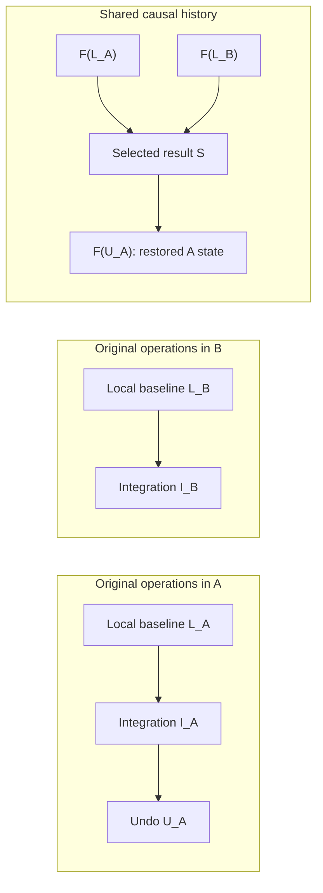

# Native Jujutsu Repository Synchronization

Source: [RFC in
Pages](https://chatgpt.com/space/page_5d42524a317c819181b2914566d74923)

**Status:** Draft for review. This document describes the original design, which
uses a separate shared causal graph. The current implementation uses native
operation merges and `jj op restore` for recovery. This revision changes the
writing; the design below still needs an update.

**Related material:** [Original
plan](https://chatgpt.com/space/page_3047a1fac6088191960dd9ece015c993),
[implementation
plan](https://app.chatgpt.com/space/page_6e3b022b95908191b982d9d75c79392f),
[decision
log](https://app.chatgpt.com/space/page_69026b9d1a9881919e400e5fea6ac6c5).

## Summary

Add `jj sync` to exchange Jujutsu repository state over local filesystem paths
or SSH. Each repository can change independently. Support receiving, sending,
and exchange in both directions. Keep the original operation and view records,
commit and change IDs, and all data that the transferred histories need.

Each repository keeps its own workspaces. A separate shared causal graph records
how changes to shared repository fields relate to each other. Each receiver then
records a local integration operation with one parent. This design lets users
undo synchronization with `jj undo`. It does not install the peer's workspace
mappings or require both repositories to have the same native operation tip.

Each exchange captures the source history at a fixed point. Each endpoint saves
its result independently and records enough state to recover after a failure.
Repeating a completed step has no additional effect. The exchange is not an
atomic transaction across machines.

## Motivation and scope

Git fetch and push transfer Git objects and refs. They do not carry Jujutsu's
operation history, original views, or all jj-specific commit metadata. Copying a
repository directory can preserve more state. But it does not define how to
merge changes made independently in both repositories.

The intended user works in independent clones on multiple machines. They can
continue work on either machine and exchange both the work and its Jujutsu
history. The design must support concurrent commands that change a repository.
It must also support exchanges through a third repository.

The first version supports existing Git-backed repositories that use the
built-in operation store. It accepts compatible independent clones and unrelated
repositories. It does not check for common ancestry to decide whether an
exchange is allowed. There is no warning or override flag for unrelated
histories. Sync still checks ancestry when it merges histories and validates
data.

This version does not create destinations, support other storage backends, or
run in the background. It also does not coordinate history deletion across
repositories or copy machine configuration.

## Command interface and endpoint behavior

```sh
jj sync --receive ../other-workspace
jj sync --send 'ssh://user@host/home/user/project'
jj sync --bidi 'ssh://user@host:2222/home/user/project'
jj --ignore-working-copy sync --bidi ../other-workspace
```

Choose exactly one direction. `PEER` must be an existing workspace path or an
explicit `ssh://[user@]host[:port]/absolute/path` URL. The peer machine needs a
compatible `jj` executable on its command search path. Sync uses current heads.
It rejects `--at-operation` and `--no-integrate-operation`.

| Mode | Incoming peer history is integrated at | Integration can be undone at |
| --- | --- | --- |
| `--receive` | Invoking repository | Invoking repository |
| `--send` | Peer repository | Peer repository |
| `--bidi` | Both repositories | Each endpoint independently |

The direction determines which endpoints apply incoming history. Both endpoints
first run normal working-copy recovery and snapshotting. That includes the
source of a one-way exchange. This preparation can itself write an operation.
Each endpoint uses its own repository and workspace settings, including settings
for specific paths.

The global `--ignore-working-copy` flag suppresses snapshots and working-copy
updates at both endpoints. Every preparation, retry, refresh, and finalization
step must preserve that choice. Creating a new helper with default settings must
not reset it.

Only the workspace selected by each endpoint path participates. For a linked
workspace, find its actual shared repository. Do not automatically snapshot
other workspaces. Updates to the physical Git HEAD and index must also respect
`--ignore-working-copy`.

## Shared state and local state

A shared view contains only the fields of a native repository view that sync
exchanges.

| Surface | Synchronization behavior |
| --- | --- |
| Visible commit heads, local bookmarks and tags, remote reference state | Merge as shared repository state |
| Original operations and views | Transfer with their original IDs and bytes |
| Referenced commits, trees, files, conflicts, snapshots, hidden work, and predecessor metadata | Transfer these objects and all objects they require |
| Workspace names, working-copy commit maps, per-workspace Git HEAD observations | Keep the receiver's local values in its active view |
| Observations of physical Git refs | Keep local; use them to detect actual Git changes |
| Workspace registrations, paths, checkout journals, physical working-copy files | Keep local |
| Configuration, remote URLs, credentials, hooks, caches | Do not copy as repository settings |

Historical raw views contain the workspace fields recorded when they were
created. Preserve those bytes and names. Sync excludes these fields when it
merges live state. It does not remove them from historical records.

Two repositories can both have a workspace named `default` and have different
`@` commits. Keep these names as they are. Sync does not convert them to UUIDs,
rename or remap them, add namespaces, or adopt workspaces.

A snapshotted file arrives as commit content. Sync does not copy the working
directory. Normal local rewrite and checkout handling can update the receiver's
working-copy commit. Sync never assigns the peer's `@` to a local workspace.

Before merging, select the shared fields from each view, including the merge
base and the incoming view. Do not install the full peer view and repair
workspace maps afterward. By then, the merge might already have treated the
peer's workspace changes as local commit rewrites.

## History model

Maintain two graphs.

1. **Original operation graph:** the immutable native operations and views from each repository, with their original identities and metadata.

2. **Shared causal graph:** content-addressed events that record shared views and the earlier events whose effects they include.

A shared event contains a set of shared parent IDs in a fixed canonical order, a
projected view, and an optional originating raw operation ID. Compute its
content hash with a versioned domain separator. This encoding gives the same
event the same ID. It does not guarantee identical commit IDs when repositories
with different settings independently rewrite commits.

Retain imported raw tips as garbage-collection roots. Importing them does not
make them active local operation heads.



If the final shared views of I_A and I_B equal S, both operations normalize to
S. Their original IDs and local workspace fields can differ. The undo creates a
new descendant of S.

### Normalization rules

For an ordinary raw operation, first normalize its parents recursively. Then
create a shared event from its actual projected view and original operation ID.
Keep the event even if its shared view equals its parent's view. An unchanged
view can still record a new no-op, workspace-only operation, undo, or redo. View
equality alone does not show that sync has already applied that event.

A sync integration may refer directly to its recorded applied anchor S only
after these checks:

- It has the expected single local baseline.

- The normalized baseline is an ancestor of S.

- Its final projected view equals S's projected view.

If valid finalization adds a shared change, record that change as a new child of
S. Do not treat the changed final view as another name for S.

An integration attribute alone does not prove ancestry. During normal
normalization, reject an invalid baseline ancestry claim. If pruning invalidates
parent relationships, the rewritten operation can instead be treated as a new
event with its actual raw parents and view. Do not reuse an anchor whose claimed
ancestry failed the check. Verified local checkpoints separately retain
knowledge of history that pruning removed.

After normal recovery and snapshotting, normalize the actual current operation.
Do not use a cached advertisement in place of the current head. Before reusing
an immutable normalization boundary, check that it represents the referenced raw
operation and projected view.

## Reconciliation, local integration, and undo

Merge the shared histories using their ancestry and jj's existing rules for
reference merging and commit rewriting. Find their shared merge bases. If
necessary, merge multiple bases recursively. If there is no shared base, use the
empty shared root view. Build the required commit index before interpreting
imported views.

Unrelated histories keep separate commit roots. Sync does not create a
file-content merge that joins unrelated projects. Concurrent edits to the same
bookmark or tag can create ordinary reference conflicts. Remote names remain
reference names; sync does not transfer their machine-local URLs.

For an exchange in both directions, the initiator selects one shared result S
for the two captured histories. It sends S and its required objects to the peer.
The peer must check that S includes both advertised histories. Both endpoints
apply that result. They must not independently compute rewrites and assume that
the commit IDs will match.

Before saving its result as an active operation, each receiver refreshes its
local baseline. If the baseline changed during transfer, preserve that newer
work while applying S. Native finalization can also add shared changes. Record
these as causal descendants. A later exchange may be needed to transfer them.

Record integration I with the receiver's current baseline L as its only native
parent. Do not add peer raw operation tips as parents. This keeps I compatible
with ordinary `jj undo`.

Undo restores the receiver's prior view and creates a new causal event that
descends from the applied result. It does not contact the peer, erase downloaded
objects, or reverse the storage-format upgrade. A later exchange can carry the
reversal to another repository. If the peer is still at S, another exchange must
not restore the state that the receiver already undid.

Sync may learn about new history without changing the projected view. In that
case, it may need an empty local integration operation. Undo and redo must
retain their place in causal history even when their resulting views are equal.
After the receiver records that history, repeating the same exchange must not
create another integration for it.

## Protocol and transports

Use a framed stdio protocol served by the hidden `jj util sync-server` helper. A
local path starts a local helper. SSH starts a fixed remote helper command. Send
the repository path as protocol data; do not insert it into shell syntax. Use
normal SSH authentication and host verification.

Use stdout only for protocol frames. Use stderr for diagnostics, including
successful peer warnings, and limit how much diagnostic data the receiver
retains. Read stderr concurrently. Inherited stderr pipes must not prevent
completion. Cancel the helper if the transport fails. On Unix, cancel its
process group to terminate helper descendants too.

| Phase | Required behavior |
| --- | --- |
| Negotiate | Check protocol version, required capabilities, backend, object-hash and operation-store formats, and working-copy policy before preparation can change state |
| Prepare | Recover and snapshot both selected workspaces with their own settings; enable supported sync storage where needed |
| Capture | Fix the original and shared history tips for this exchange; save roots that protect all data they require |
| Inventory and transfer | Exchange known-ID batches within the stated limits; stage missing immutable records and stream physical Git bodies |
| Validate and retain | Check identities, encodings, metadata, and all dependencies; install incoming data and durably retain its roots before making it active |
| Select | Choose the receiving result; in bidi, transfer the one selected S and confirm that the peer is ready for that exact result |
| Publish | Refresh each receiver, finalize through the normal native path, save its intended operation, then make that operation active locally |
| Complete | Recover or finish local state and acknowledge the captured result; report newer local state separately |

Before capture, the endpoint must have exactly one active native operation head:
the operation it loaded. If it has concurrent heads, refresh and resolve them
through normal jj loading before retrying. Do not capture an unresolved set of
heads. The reference command retries stale capture up to eight times. If the
repository keeps changing, it asks the user to retry.

The first transfer offer must match the history tips advertised at capture. A
sender cannot replace that captured history during an exchange.

Success means that the requested receivers incorporated the captured histories.
Their native tips and checkout files can still differ. Concurrent edits can
remain for a later exchange. The command does not complete atomically across
machines. Do not keep snapshotting and merging until live tips match: continuous
edits could prevent the command from finishing.

A retry may send records again and recompute the merge. It does not need to
resume an interrupted byte stream at a specific offset.

## Immutable transfer and validation

Transfer the retained original and shared histories and all their dependencies.
These include original operations and views; shared events and their origins;
operation predecessor references; Git commits, trees, and blobs; exact jj commit
extras; and legacy conflict trees referenced only by extras.

The backend can also transfer Git tag objects when they are explicit roots. The
standard command exchanges jj tag targets. It does not mirror physical Git refs
or guarantee that it preserves their annotated-tag objects.

Preserve commit IDs, change IDs, raw operation and view IDs, and supported
historical encodings. Operation IDs are not always hashes of serialized protobuf
bytes. Validate them with the supported identity rules and retain the original
bytes. Reject unsupported identities or inconsistent immutable extras with an
explicit error. Do not decode historical records and silently serialize them
again under a different identity.

Stage incoming data in a quarantine directory on disk. Check framing, record
identity, all dependencies, and compatibility with existing immutable metadata
before allowing the data to become active. During installation, check metadata
conflicts again while holding the relevant writer lock. Staging and installing
immutable data do not activate the incoming live view.

A framing checksum detects corruption; it does not authenticate the sender.
Content-addressed identities do not prove authorship. SSH authenticates and
encrypts the transport. Both transports still require checks of repository
semantics and object identities.

## Durable state, publication, and failure recovery

Store sync metadata locally alongside the receiving repository. This includes
immutable shared events, an atomically replaced state file, peer roots, transfer
pins, and a verified local normalization boundary. Also store knowledge that
must survive operation-history pruning and records of operations being made
active.

Use an opaque repository ID for tracking. It does not prove that repositories
are related. Do not reject independent copies just because their IDs match.
Reject a self-exchange only when, for example, a local path can be shown to
address the same shared store.

Each receiving session records its local baseline, incoming raw and shared
roots, selected applied anchor, intended result operation, and progress toward
making it active. Before waiting on the network, save pins that protect the
outgoing objects already present locally. Keep incoming data in quarantine until
all checks pass. Under the local sync/GC lock, install the incoming objects and
save their accepted roots. Garbage collection must not be able to remove an
accepted object between installation and saving its roots.

Make the receiving operation active in this order:

1. Finalize the prepared transaction through normal jj behavior. This includes rewriting descendants and any permitted local Git and working-copy work.

2. Hold the local sync/GC lock and write the exact final operation object.

3. Save a write-ahead record that names that exact operation and the applied anchor.

4. Make the native operation head active while the same lock still protects the record and retained objects.

5. Finish ordinary checkout or recovery, then record that tracking is complete.

Acquire the ordinary Git and working-copy locks before the short-lived lock that
protects sync state changes. Release the sync/GC lock before waiting on the
network or acquiring a working-copy lock.

Acquire a separate process lease before preparing a pending operation. Hold it
until the publishing process finishes. Recovery must not remove a pending
session while a live process still owns it.

| Interruption | Recovery contract |
| --- | --- |
| Incomplete transfer or invalid data | Do not activate the incoming view; a retry can transfer missing data |
| Write-ahead record saved, operation not active | Retain installed roots; once no live process owns the session, retry from a fresh safe baseline |
| Operation active, acknowledgment lost | Inspect durable active ancestry, including ancestors of newer heads; a missing acknowledgment does not mean rollback occurred |
| One bidi endpoint completed, the other failed | Keep the completed result and retry the exchange independently |
| Checkout fails after the operation becomes active | Keep the active operation and use ordinary jj checkout recovery |
| Process exits after making the operation active but before final sync capture | Preserve causal knowledge before any later pruning of native operation history |

After an interrupted checkout, recovery preserves physical files as working-copy
edits against the saved intended state. This includes edits made after the
interruption. A retry must not overwrite those files with the old intended
checkout.

The design does not use a distributed lock or two-phase commit. When the command
reports an error, one or both receivers may already have made their result
active. The diagnostic must say that this is possible.

## Operation pruning and garbage collection

`jj op abandon` maintains the local operation log. It does not ask peers to
forget transferred history. Abandoning a commit or deleting a bookmark still
changes shared repository state.

Before a sync-enabled repository changes operation parents to prune history,
normalize all actual current raw heads. Save their shared frontier. This step
must use the operation and view stores without requiring the commit backend to
load. That preserves the ordinary command's use for recovery.

Hold the sync/GC lock while creating the operations with new parents and making
their native heads active. Release it before taking a working-copy lock. At the
next safe capture with one head, join the retained frontier with the actual
current shared history. Use the actual current projected view. Save the new
local boundary and clear the pending frontier in one atomic change. If pruning
starts with multiple heads, retain every branch's knowledge. Do not select one
branch's view as the repository result.

This order preserves knowledge when a process makes an operation active, exits
early, and is followed by undo and pruning before the next sync capture. The
knowledge of the original applied result must survive. This also applies when
the previous cached boundary is still an ancestor of the rewritten raw graph.

Garbage-collection roots include active local operation heads, retained raw peer
heads, shared anchors and event origins, and integration cross-links. They also
include live transfers, pending sessions, local normalization boundaries, and
frontiers saved before pruning. Follow every dependency from these roots.
Include operation and view history, commit ancestry, predecessors, and legacy
tree terms referenced only by extras.

Protect every retained object throughout collection, including `jj util gc
--expire now`. Build a private retention index when imported histories are
outside the active index. Retain peer raw roots as GC roots without making them
active operation heads.

If sync tracking is missing or invalid in an enabled repository, stop garbage
collection. Do not recreate empty tracking and collect history that the missing
state may have protected.

The reference implementation does not expire durable transfer pins based on
time. A killed process can therefore leave extra data retained. A separate
policy must define when cleanup is safe and how much data to retain. A timeout
does not prove that the process failed to make its operation active.

## Physical Git observations

Shared remote-reference targets differ from observations of physical Git refs.
After sync, a shared target can differ from a physical ref that has not changed.
If the next ordinary command treats that ref as a new Git edit, it would reverse
the synchronized state.

Keep physical observations local. Compare current Git refs with those
observations to identify actual changes. Initialize observations of remote tags
before applying the first incoming shared state. Scoped fetch, deletion, remote
rename, and remote removal must continue to work correctly.

Normal Git import, export, and working-copy finalization continue to run. Sync
does not copy a peer's Git observations or remote URLs into local configuration.

## Resource limits, disclosure, and performance

An exchange gives the receiver access to all retained content being transferred.
This includes hidden or abandoned commits, snapshots, historical workspace
names, and operation metadata. Use it with a peer intended to receive that full
history. It does not filter or redact content. Sync need not copy unreachable
garbage, and it cannot recover data that garbage collection has already removed.

The receiver sets resource limits and checks them before expensive decoding or
allocation. The sender cannot override them.

| Setting or bound | Initial behavior |
| --- | --- |
| `sync.max-quarantine-bytes` | Optional positive byte count or human-readable size; default derives from available disk space with reserve and installation room |
| `sync.max-records` | Positive count; default 1,000,000; bounds staging reservations and validated closure, including already-known receiver records |
| `sync.max-dependencies` | Positive count; default 1,000,000; also bounds wire fields in each protobuf metadata record, including nested messages |
| Known-ID cache | At most 65,536 IDs; omissions cause safe retransmission |
| Inventory batches | At most 512 IDs and 96 KiB of JSON |
| Phase controls | At most 64 KiB before JSON decoding |
| Physical Git streaming chunks | At most 1 MiB per chunk; no permanent 64 MiB limit on a physical Git object |
| Protocol frame | At most 128 MiB; metadata records have separate byte and complexity bounds |

For the default quarantine byte limit, reserve the smaller of 1 GiB or ten
percent of available disk space. Use at most half the remaining space, leaving
room for installation. Count metadata and per-file allocation overhead. Limit
active streams and dependency work, and check free space again during staging.
Check protobuf field and depth limits before allocating decoded collections.
Limit Git commit header parsing separately from opaque message bodies.

The first exchange can walk all retained operation and shared graphs and their
referenced objects. Later captures can reuse verified immutable boundaries. But
the reference implementation can still enumerate retained inventories. Graph and
inventory memory can grow with retained history. Streaming limits the memory
used to buffer physical objects. It does not make the whole sync use constant
memory for repositories of any size.

The known-ID cache improves transfer efficiency. Its size limit does not
restrict repository size. Operators can raise local staging and complexity
limits for larger histories. Limits on retained history across peers, and
deletion of peer history, need a separate design.

## Compatibility and first enablement

Use the existing operation-store type dispatch to prevent older binaries from
opening an enabled store. On first use, initialize and durably save sync
tracking and shared-event storage. Then enable the `simple_op_store_sync_v1`
type. Keep supported historical operation and view bytes unchanged.

Older binaries must reject the enabled store when they open it. Otherwise, they
could run GC without the new roots. Missing enabled-state files must not cause a
repository to be treated as new.

The type marker cannot stop an old process that has already opened the store.
Finish older repository commands before enabling sync, then use compatible
binaries. The marker does not exclude old clients that are already running.

Before preparation can change endpoint state, negotiate the protocol, required
capabilities, backend, object hash, and operation-store formats. Preserve
supported legacy identity rules. Reject unsupported or inconsistent data. This
version does not downgrade automatically. Undoing an integration does not
downgrade the store.

## Alternatives considered

| Alternative | Reason for this design |
| --- | --- |
| Use only Git fetch/push | Omits operation and view history and required jj metadata |
| Copy or rsync repository directories | Does not define how to merge independent changes or when a native operation becomes active |
| Activate peer raw operation tips directly | Imports peer workspace fields and produces native operation merges without the required single-parent undo behavior |
| Share only the latest projected view | Loses causal distinctions, including operations with the same view and undo/redo history |
| Rewrite historical workspace names or use UUID names | Changes historical identity and adds an unnecessary workspace protocol |
| Recompute bidi reconciliation independently at both ends | Receiver settings can produce different rewritten commits; choosing one result avoids that ambiguity |
| Require common Git ancestry | Excludes compatible unrelated repositories and is unnecessary for the chosen merge rules |
| Wait for equal live tips | May never finish if concurrent edits or finalization keep changing state |
| Coordinate deletion across peers now | Adds a distributed contract for retaining and deleting history beyond local operation pruning |

## Reference implementation and validation

The original local reference implementation was recorded on
`dev/adamh/repo-sync` at tip `73fbf6e0`. Its review commits separate
immutable-store primitives, the shared causal model, transfer and quarantine,
and durable retention and recovery. Other commits cover physical Git
observations, the native command, and generated files. The validation below
refers to that saved version.

Focused validation of that saved implementation passed 59 library sync unit
tests, 19 matching library integration tests, 20 command/transport unit tests,
and 28 command integration tests. The tests covered:

- Independent and unrelated repositories, all three directions, exact raw records, and local workspace maps.

- Snapshot defaults and ignore behavior at both ends, endpoint-specific settings, and selected linked workspaces.

- Causal events with the same view, undo and redo, repeated exchanges, and three-peer cycles.

- Concurrent edits, crossed sessions, GC during transfer, and failures injected before and after operations became active.

- Interrupted-checkout recovery preserving later physical edits.

- Interrupted saves followed by undo, operation pruning, immediate GC, and retry with one or multiple native heads.

- Valid pruning checkpoints and rejection of unverified integration-anchor ancestry.

- Large physical Git objects beyond 64 MiB, including a packed blob through the command.

- Limits set by the receiver, decoding limits, inventory fallback, helper diagnostics, and process cleanup.

A stand-in helper tested SSH arguments and paths. These tests did not exercise a
live remote SSH connection. Windows-specific APIs were checked in source but
were not run. Failure injection covered the identified steps for making an
operation active. It did not cover every network interruption or filesystem
failure.

Generated help checks, formatting of changed files, and focused Clippy checks
passed. Broader tests found four failures in untouched working-copy and ignore
tests. Whole-workspace lint and format checks found other existing issues. These
results do not establish a fully passing workspace-wide CI run.

Reviewers should check causal normalization and the validity of checkpoints.
They should also check that GC reaches every retained object, locks are acquired
in the required order, native recovery works, and first enablement enforces the
stated compatibility rules.

## Deferred work

Future proposals can cover other backends, destination creation or cloning
through sync, named peers, and background exchange. They can also improve
inventory negotiation, coordinate retention and deletion, or add a user-selected
ancestry policy.

This draft's first version requires an explicit direction and uses ordinary
snapshots. Repositories can be independent, and workspaces and operation-log
pruning stay local. It proposes native undo and recovery of results saved
independently at each endpoint.
